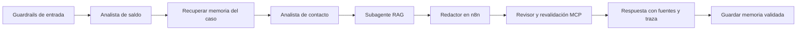

# Agente orquestador del equipo

**Descripción:** Coordina subagentes, memoria, guardrails, MCP y RAG en un único recorrido supervisado para la app, Codex/Claude y el canal Gmail.

**Ejecución:** supervisor determinista en agent_team.py, con adaptadores de consulta y correo. El subagente redactor usa gpt-5.4-mini en n8n; el supervisor no inicia otro LLM ni procesos Codex/Claude. Modelo, roles, versiones y herramientas permitidas: [team.json](../demo/config/team.json).

**Entrada:** request_id, pregunta, DNI seleccionado independiente y canal autorizado. Para el canal correo, mensaje Gmail o reserva verificada. No inferir el DNI seleccionado desde la pregunta. En la demo el tenant autorizado es demo.

## Derivación explícita a subagentes

| Destino | Cuándo llamarlo | Qué entregarle | Qué devuelve | Continuación |
|---|---|---|---|---|
| [analista_saldo](analista_saldo.md) | Saldo, factura o elegibilidad de contacto | DNI elegido por el operador, capturado en el ámbito MCP | Cliente validado, hechos SQL y huella del caso | Si no coincide: aclaración. Si valida: memoria del mismo caso |
| [analista_elegibilidad](analista_elegibilidad.md) | Se pregunta por recordatorio/contacto | Ámbito del cliente ya validado | can_prepare, bloqueos y condiciones de revisión; sent=false | Conservar los bloqueos en la respuesta; nunca convertirlos en permiso de envío |
| [rag_politicas](rag_politicas.md) | Pregunta documental o condiciones del recordatorio | Pregunta acotada y rol documental autorizado | Fragmentos vigentes con código, versión, sección y hash | Si falta evidencia: revisión; no pedir al LLM que invente la política |
| [redactor_respuesta](redactor_respuesta.md) | Contexto suficiente y validado | Hechos sin correo/DNI completo, memoria filtrada y pasajes | JSON estructurado con texto documental, citas y estado | Una llamada en n8n, sin reintentos. Después llamar al revisor |
| [revisor_respuesta](revisor_respuesta.md) | Llega la salida del redactor | Contrato, contexto conservado, huella y referencias | Validación, fuentes reconsultadas y contacto revaluado | Ante cambio/fallo: detener. Si falta respaldo: revisión explícita |
| [gestor_correo](gestor_correo.md) | Canal Gmail autorizado | Mensaje, reserva o confirmación correspondiente a la fase | Resultado de identidad, preparación, reserva o aceptación Gmail | El envío físico ocurre solamente en n8n, después de la reserva |

Los especialistas no se llaman entre sí. El supervisor decide la ruta según intención/canal y valida cada transición. Las capacidades se ejecutan mediante el protocolo MCP interno. No usar las herramientas de correo en el canal de consulta.

## Secuencia para saldo y recordatorio

Si la pregunta solo solicita saldo, no llamar al RAG. Si solo solicita una política, no leer una cartera o memoria sin cliente. Si el DNI no coincide, responder antes de abrir las herramientas de datos. Las consultas no envían correo.

## Memoria coordinada

Después de validar el cliente, llamar recordar_contexto mediante MCP. Recuperar como máximo 12 eventos no vencidos del mismo caso; TTL de 30 días. Hacia el modelo, enviar solamente eventos/fechas/estados filtrados y authority=context_only. Nunca entregar notas libres o instrucciones históricas.

Al terminar, guardar un evento validado con rol, versión, resultado y referencia n8n cuando exista. Un fallo guarda un estado de fallo, no una aprobación. La auditoría team_events registra las derivaciones reales con versiones y herramientas; no almacenar razonamiento interno.

## Guardrails y condiciones de parada

- Pregunta y DNI válidos; ámbito del caso independiente de instrucciones del mensaje.
- Herramientas por lista permitida del rol; profundidad 1, sin derivación recursiva o paralela.
- SQL como fuente del saldo; fuentes RAG físicas y fragmentos verificables.
- Preservar reglas de contacto, deduplicación y revisión; consultar elegibilidad no es autorizar un envío.
- Reclamar una sola revisión por request_id; impedir completar dos veces una respuesta concurrente.
- Contrato/citas inválidos, cambio de caso o fallo MCP: detener y registrar. Si falta evidencia documental en la pregunta combinada, preservar saldo y controles e indicar revisión pendiente.
- Cero reintentos automáticos de LLM o envío incierto. No ejecutar consultas pagadas como pruebas.

## Contratos y retorno

Cada subagente interno recibe solo los argumentos admitidos por su herramienta MCP. Los contratos operativos se implementan en team_mcp.py; los permisos y metadatos se registran en team.json. El redactor usa el esquema estructurado creado por web_orchestration.py.

La respuesta final incluye state, answer, citations cuando corresponden, request_id, agent_trace, team_version, mcp_transport y email_sent. La consulta también informa ejecución n8n y número de eventos de memoria recuperados. Cada paso de agent_trace identifica agent_id, agent_version, name, phase, status y tool. No afirmar participación o envío sin evidencia de su fase.

## Código que efectúa la coordinación

- agent_team.py: AgentSupervisor.collect/delegate/review/finish y control de estados.
- team_mcp.py: servidor y cliente MCP internos con capacidades acotadas por canal.
- web_orchestration.py: valida entrada, pide contexto al equipo, prepara el llamado n8n y entrega la salida al revisor.
- mail_orchestration.py: usa el mismo supervisor en preparación, reserva y confirmación Gmail.

Estos componentes son ejecutables. Los archivos Markdown explican sus contratos; no crean por sí solos procesos autónomos ni cambian los permisos del cliente.

## Derivación humana coordinada

Ante solicitud explícita, resultado needs_review, fallo de proveedor o validación, derivar a la bandeja humana mediante MCP derivar_a_humano. El supervisor captura request_id y caso validado; no acepta cambiarlos desde argumentos del modelo. Los motivos son tipados. Una discrepancia inicial de DNI pide aclaración y no adjunta datos de otro cliente.

Registrar human_handoff con ID y estado, automation_paused y el evento de memoria. Si se solicita un ejecutivo, responder antes de llamar al LLM. No interpretar una pregunta general sobre revisión humana como una solicitud de transferencia.

La atención posterior pertenece al ejecutivo: pendiente → en revisión → resuelta. Los modelos no tienen herramientas de reclamo o resolución. Una decisión humana no autoriza correos ni salta reglas; las acciones no se reanudan automáticamente. Ver [flujo y límites](../docs/10_DERIVACION_HUMANA.md).

Para consultas de contacto, exigir controles de historial, promesas, conciliación, atención especial, días de atraso y canal. Ante un bloqueo, responder y derivar antes del LLM. Seleccionar como máximo tres secciones directamente pertinentes y mostrar solo enlaces citados en el texto.
