# Planificación de la demo

```mermaid
flowchart LR
 A[Describir el flujo manual] --> B[Definir objetivo y límites]
 B --> C[Separar reglas y decisiones]
 C --> D[Elegir agente o multiagente]
 D --> E[Diseñar datos, RAG y MCP]
 E --> F[Elegir LLM y presupuesto]
 F --> G[Memoria y guardrails]
 G --> H[Planificar pruebas y Evals]
 H --> I[Implementar y observar]
 I --> J[Validar y mejorar]
```

## Flujo manual que se automatiza

| Trabajo del ejecutivo | Componente de la demo | Control verificable |
|---|---|---|
| Identificar al cliente | Validación de correo/DNI o DNI seleccionado | Coincidencia y ámbito del operador |
| Buscar deuda y vencimiento | Consulta SQLite | Saldo exacto, factura y versión |
| Leer la política de contacto | Subagente RAG | Documento, versión, sección y hash |
| Decidir si procede contacto | Motor de reglas | Saldo, disputa, consentimiento, bloqueo y contactos previos |
| Redactar el mensaje | Plantilla o rol redactor | Sin amenazas ni cambios de monto/destinatario |
| Revisar la propuesta | Rol revisor y backend | Detener si falta evidencia o cambia el caso |
| Enviar y registrar | Workflow Gmail o outbox sintético | Reserva, deduplicación y confirmación del proveedor |

## Elección del patrón

Un agente con herramientas basta para una consulta acotada de saldo/políticas. El multiagente se enseña para separar análisis, redacción y revisión de una propuesta. La autonomía se limita a un evento autorizado: por ejemplo, un Gmail Trigger procesa una consulta de prueba con controles de identidad y envío. No se concede libertad para modificar deudas o contactar arbitrariamente.

## Elección del LLM

Elegirlo después de definir tareas, contratos, herramientas y datos; antes de cerrar coste, latencia y Evals. Predeterminado del workflow: gpt-5.4-mini, una llamada como máximo por pregunta, sin reintentos automáticos. Embeddings: embeddinggemma local. Generación del RAG histórico: qwen3:4b local. Codex/Claude usan sus modelos configurados para operar como clientes.

## Planificación de pruebas con Evals

Antes de implementar, definir casos normales, ambiguos y adversariales; resultados esperados; fuentes de verdad; controles que no dependen del LLM; umbrales y revisión humana. Ver evals/README.md. Los tests tradicionales validan contratos y bloqueos exactos; las Evals juzgan la calidad de una respuesta variable y su comportamiento completo.
