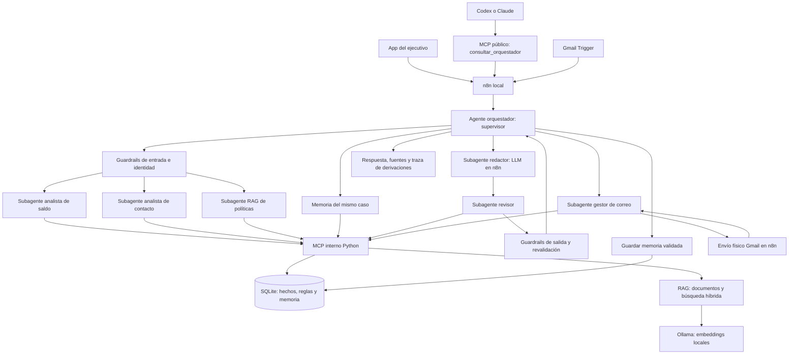

# Arquitectura: un equipo orquestado

La arquitectura principal de la versión 0.5.0 utiliza un supervisor ejecutable, especialistas, memoria, guardrails, MCP Python y RAG. La app y Codex/Claude entran por el mismo workflow n8n. El canal Gmail usa el mismo supervisor y una capacidad de correo separada.

## Responsabilidades y ejecución

| Componente | Implementación | Función |
|---|---|---|
| Orquestador | AgentSupervisor + ChatOrchestrator/MailOrchestrator | Selecciona el recorrido por intención/canal, deriva, controla estados y registra resultado |
| Analista de saldo | Especialista determinista | Consulta SQL del cliente seleccionado mediante MCP |
| Analista de contacto | Especialista determinista | Evalúa reglas y bloqueos mediante MCP |
| Especialista RAG | Recuperador documental | Obtiene fuentes vigentes/autorizadas mediante MCP; no calcula saldos |
| Redactor de respuesta | LLM gpt-5.4-mini en n8n | Redacta con evidencias y contrato estructurado; sin herramientas de envío |
| Revisor de respuesta | Especialista determinista | Valida contrato, citas, cambios de caso e historial mediante MCP |
| Gestor de correo | Especialista determinista | Prepara, reserva y registra confirmación; Gmail Send permanece en n8n |
| Memoria | SQLite acotado al caso | Recuperación filtrada y eventos tipados; nunca autoridad sobre reglas |
| Guardrails | Backend | Identidad, contratos, ámbitos, fuentes, contacto, duplicidad y revalidación |

Los especialistas deterministas son módulos ejecutables con tareas y herramientas acotadas; no se presentan como modelos LLM independientes. Esta arquitectura supervisada mantiene **una llamada OpenAI como máximo por consulta**, sin reintentos automáticos. No es un planificador LLM de delegación libre.

## MCP real en ambos niveles

El cliente Codex/Claude usa el perfil público de consulta por stdio o HTTP. Dentro del supervisor se crea una sesión cliente-servidor con el SDK oficial MCP y transporte en memoria. Se intercambian initialize, tools/list y tools/call con validación del protocolo; no es una llamada directa a una función presentada como MCP.

Las herramientas internas de consulta son saldo_cliente, recordar_contexto, evaluar_contacto, recuperar_politicas y verificar_contexto. El perfil interno de correo expone solamente preparar_consulta_correo, reservar_respuesta_correo y confirmar_envio_correo. Las herramientas de correo no están disponibles para los subagentes de consulta. La lista permitida por agente se carga de demo/config/team.json.

Los nodos HTTP de n8n conectan con el backend; no son por sí mismos clientes MCP. La sesión MCP interna se crea en el backend y no necesita un puerto o token adicional. La escritura de memoria y auditoría la realiza el supervisor mediante transacciones del backend.

## Derivación condicional

- Saldo: analista de saldo → memoria del caso → redactor → revisor → memoria validada.
- Política sin cliente: RAG → redactor → revisor. No consultar memoria de otro cliente ni inventar uno.
- Saldo y recordatorio: saldo → memoria → contacto → RAG → redactor → revisor → respuesta y memoria.
- DNI discordante: guardrail de entrada → aclaración, sin subagentes de datos ni OpenAI.
- Gmail: gestor de correo con identidad y SQL → reserva/revalidación → Gmail Send de n8n → confirmación. No requiere LLM ni RAG para una consulta exclusivamente de saldo.

No todos los especialistas deben ejecutarse en todas las preguntas. Cada respuesta incluye agent_trace con rol, versión, fase, estado y herramienta. La app permite desplegar ese recorrido. Un rol pendiente de n8n no se registra como completado; un bloqueo o fallo deja una traza de parada.

## Memoria y auditoría

memory contiene eventos del caso con TTL de 30 días y recuperación máxima de 12. team_runs/team_events guardan el estado y la traza de la coordinación. La lectura hacia el modelo solo incluye evento, fecha y estado permitido; no incluye notas libres, instrucciones, otros clientes o secretos. El RAG documental es distinto de la memoria de conversaciones.

## Compatibilidad

Se conservan endpoints, webhook y contratos de entrada/salida principales: no es necesario cambiar credenciales ni importar de nuevo el workflow para esta integración Python. Los JSON distribuidos siguen sin credenciales y desactivados. El motor anterior de cuatro roles LLM de cobranza.py y config/agents.json queda como ejercicio histórico; el equipo principal es config/team.json.

Puertos: gateway/app/MCP HTTP 8790; n8n 5678; RAG 4173; Ollama 11434. En otra instalación se reconstruyen bases e índice y se conectan las propias credenciales. No trasladar el historial o los tokens del docente.
