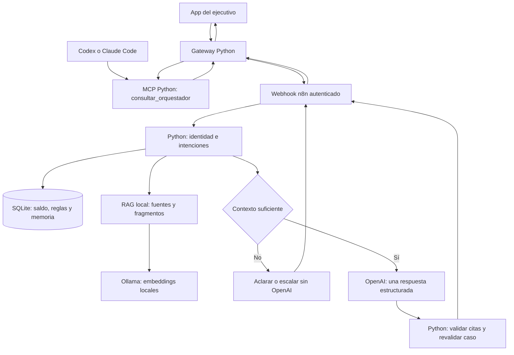

# Arquitectura y recorridos

## Consulta del ejecutivo: app, Codex o Claude

En este recorrido el RAG recupera documentos, pero la respuesta documental se genera en OpenAI mediante n8n. No hay cuatro llamadas LLM por consulta: los roles adicionales pertenecen al recorrido didáctico separado. Las cifras se muestran mediante una plantilla construida con SQL.

MCP ofrece herramientas a los clientes. Los nodos n8n llaman las mismas capacidades del backend mediante HTTP autenticado; esos nodos HTTP no hablan por sí mismos el protocolo MCP.

## Multiagente didáctico incluido

`demo/config/agents.json` y `demo/src/cobranza.py` definen un supervisor con orden orquestador → analista → redactor → revisor, profundidad máxima 1 y sin llamadas paralelas. El orquestador consulta el RAG y la memoria del caso. Los agentes devuelven el contrato JSON de `demo/config/agent-response.schema.json`; el backend valida, reconsulta reglas y captura un correo sintético en modo demo. El modo con Codex real es opcional y puede consumir cuota; no se usa en tests.

## Consulta por Gmail

Gmail Trigger → normalizar remitente → correo/DNI → saldo → preparar/reservar → Gmail Send → registrar aceptación. Este workflow no consulta el LLM. Solo admite autoenvíos de la cuenta de prueba con SENT e INBOX. Ver docs/07_CORREO.md.

## Componentes y puertos

| Componente | Puerto | Datos persistentes locales |
|---|---|---|
| App, gateway y MCP HTTP | 8790 | demo/data/cobranza.sqlite y token interno |
| n8n | 5678 | Volumen propio de n8n, fuera de Git |
| RAG | 4173 | rag/03_Demo_Cobranza/data/ |
| Ollama | 11434 | Modelos administrados por Ollama |

El correo del alumno y las credenciales no se obtienen del corpus. La memoria no es el RAG: la primera registra eventos de un caso; el segundo recupera documentación.
