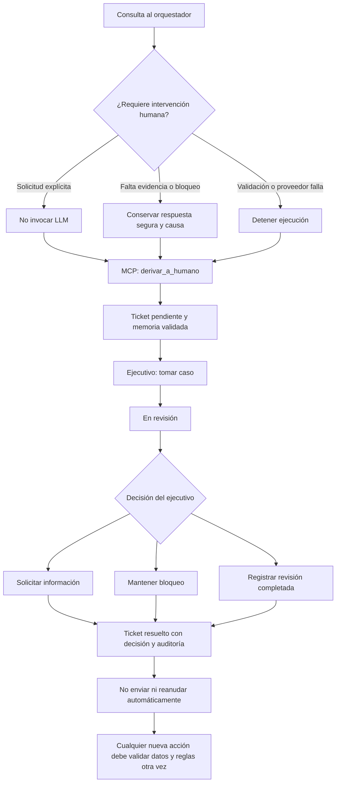
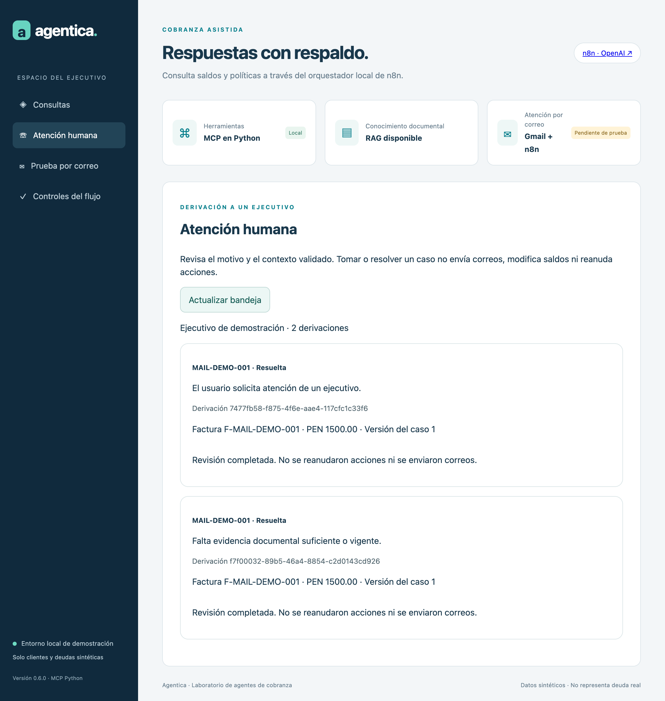

# Flujo de derivación humana

La versión 0.6.0 incorpora una bandeja local en la app: **Atención humana**. No envía notificaciones externas ni representa que un ejecutivo haya sido contactado por correo. El supervisor crea el ticket mediante MCP y el ejecutivo entra a la bandeja para atenderlo.



## Motivos de derivación

| Motivo | Qué conserva el sistema |
|---|---|
| Solicitud explícita de un ejecutivo | Ticket sin invocar OpenAI ni RAG; si el caso no está validado, no adjunta datos de deuda |
| Evidencia insuficiente | Contexto validado y motivo; no inventa una política |
| Reglas de contacto bloqueadas | Causa del bloqueo y datos mínimos del caso |
| Fallo de validación | Incidencia tipada; nunca el texto libre de la excepción o del mensaje |
| Fallo del proveedor | Motivo operativo; no exporta claves o mensajes técnicos sensibles |

Una discrepancia inicial de DNI solicita aclaración antes de leer la cartera; no adjunta el cliente seleccionado a una solicitud que menciona otro DNI. Una pregunta sobre una política de revisión humana no equivale a pedir una transferencia.

## Datos del ticket

ID, request_id, ámbito demo, caso validado cuando corresponde, motivo tipado, estado, ejecutivo asignado, decisión y fechas. El contexto es una instantánea mínima de factura, saldo, moneda, vencimiento y versión del caso. No contiene el DNI completo, correo, pregunta libre, razonamiento ni credenciales. Una derivación sin caso validado no muestra deuda.

Las tablas human_handoffs y human_handoff_events registran el ciclo. Una misma request_id no crea tickets duplicados. El supervisor y el revisor humano guardan eventos tipados en la memoria del caso. La memoria no puede convertir un ticket en permiso para enviar.

## Estados y acciones del ejecutivo

1. **Pendiente:** el ejecutivo pulsa «Tomar caso». El reclamo es atómico y solo puede completarse una vez.
2. **En revisión:** revisar el motivo y la instantánea del caso. Registrar «Solicitar información», «Mantener bloqueo» o «Revisión completada».
3. **Resuelta:** queda el resultado y la auditoría. No se reanudan procesos ni se envían correos al cerrar.

«Solicitar información» registra la decisión; no manda automáticamente una solicitud al cliente. «Mantener bloqueo» conserva el bloqueo de contacto. «Revisión completada» cierra el ticket, pero no anula disputas, consentimiento, saldo cero u otras reglas. Un nuevo intento debe evaluar el estado vigente; no hay un botón de «aprobar y enviar».

Mientras exista una derivación pendiente o en revisión del caso, las reglas bloquean nuevos recordatorios y la reserva de una respuesta Gmail. Si Gmail se preparó antes de la derivación, se vuelve a comprobar el bloqueo antes de reclamar el envío. El workflow no debe reintentar mensajes anteriores automáticamente después del cierre.

## Permisos

La herramienta MCP interna de derivación solo puede crear el ticket, dentro del ámbito capturado por el supervisor. No expone tomar, resolver o enviar al modelo. Los endpoints de la bandeja requieren la sesión autenticada del ejecutivo o el acceso interno autorizado. Para esta demo existe un único actor fijo: ejecutivo-demo; no hay identidad empresarial ni roles de múltiples personas.

El asistente Codex/Claude no debe resolver casos reales por iniciativa propia. La decisión debe proceder del operador autorizado. Las pruebas automatizadas de reclamo/cierre se realizan exclusivamente sobre bases y tickets temporales sintéticos.

## Demostración sin consumir OpenAI

En la app o el MCP, preguntar: **«Quiero hablar con un ejecutivo humano»**. La ruta omite el LLM y registra la derivación. Abrir Atención humana, tomar el caso y registrar la revisión. Si falta validar el cliente, el ticket no muestra información de deuda.

La prueba aislada de n8n se ejecuta con:

```sh
python3 scripts/probar_n8n_aislado.py --human-handoff
```

El nodo que reemplaza al modelo falla si se ejecuta: la prueba solo aprueba cuando la derivación termina por la rama sin LLM. No utiliza Gmail ni las credenciales del docente.

## Evidencia visual de prueba

La siguiente captura corresponde a tickets sintéticos de una base temporal, no a decisiones sobre solicitudes reales.


