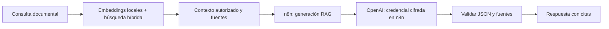

# Generación del RAG con OpenAI

El RAG independiente de puerto 4173 usa por defecto gpt-5.4-mini mediante el workflow autenticado agentica-rag-openai de n8n. La API key reside en la credencial OpenAi account de n8n; no se copia a Node, Python, frontend, Markdown o Git.

Los embeddings siguen con embeddinggemma en Ollama y el índice sigue en SQLite/FTS5. Cambiar generación no requiere reconstruirlo. En modo OpenAI el orden de RRF selecciona el contexto sin otra llamada al LLM: máximo una llamada por consulta documental, sin reintentos o fallback automático. Las Evals que utilizan jueces LLM pueden generar llamadas adicionales y no se ejecutan durante la preparación.

Importar demo/n8n/rag-openai.json y asignar Header Auth del token interno y OpenAI API de la clase. Publicar el workflow. El modelo y los límites se fijan en el nodo de validación de entrada; no se aceptan modelos, URL del proveedor o herramientas arbitrarios del usuario.

El cliente Node lee el token interno desde COBRANZA_GATEWAY_TOKEN_FILE o, en el repositorio portable, demo/data/gateway.token. Esa variable apunta al token del backend, **no a la API key**. RAG_OPENAI_WEBHOOK permite el endpoint local, sin URLs externas o redirecciones.

La app de cobranza ya usaba OpenAI/n8n. Su subagente RAG consulta solo índice y fragmentos; no llama esta generación adicional y no duplica llamadas de modelo.

Para usar Ollama deliberadamente: RAG_GENERATION_PROVIDER=ollama y GENERATION_MODEL=qwen3:4b. No se utiliza como fallback si OpenAI falla.

La integración utiliza Responses API y JSON Schema estricto según [OpenAI Docs](https://developers.openai.com/api/docs/guides/structured-outputs). Las pruebas del puente sustituyen el proveedor; no comprueban con consumo real la disponibilidad de la cuenta ni una mejora semántica cuantificada.
