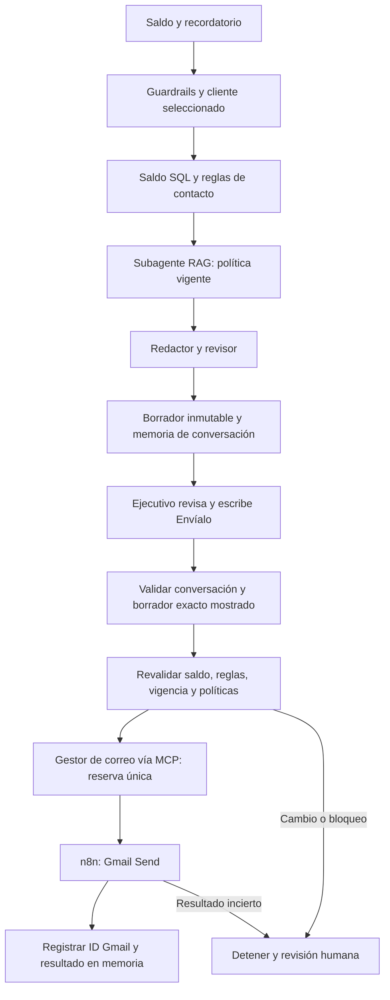

# Borrador y confirmación · versión 0.8.1

## Demostración

1. Abre la app; no necesitas seleccionar un cliente previamente.
2. Pregunta: «¿Cuál es el saldo de 71425836 y puedo mandarle un recordatorio de pago?».
3. Si el caso y las políticas validan, se muestra **Borrador preparado (aún no enviado)** con destinatario, asunto y cuerpo completos.
4. Revisa el texto. Escribe **Envíalo** para enviarlo realmente mediante Gmail/n8n a **contacto@agentica.com.pe**, o **Cancela el borrador**.
5. El asistente informa aceptación Gmail con referencia de ejecución. Repetir la confirmación no duplica el envío.

Las respuestas anteriores a 0.8 solo evaluaban condiciones y no generaron borradores. Se debe repetir la primera pregunta para preparar uno. El borrador se guarda en SQLite, no en la carpeta Borradores de Gmail.

## Memoria y autorización

El chat conserva los últimos 20 turnos durante 30 días. La app restaura historial y cliente activo al recargar; una cookie firmada HttpOnly vincula la conversación. La demo utiliza un actor ejecutivo compartido y no representa autenticación empresarial multiusuario.

Cada borrador caduca a los 30 minutos y conserva destinatario, asunto, cuerpo, huella del caso, citas y hash del contenido. La confirmación se vincula al draft_id efectivamente mostrado; una pestaña desactualizada no puede aprobar otro borrador. Sin borrador, turno de presentación o confirmación real, se solicita aclaración. No se aceptan cambios de destinatario en la orden de envío.

Los estados son draft → approved → sending → sent. También existen cancelled, superseded, blocked y unknown. La reserva y el outbox impiden duplicar una factura. Si Gmail no confirma aceptación, se marca unknown y se deriva a revisión humana; no se reintenta automáticamente. Resolver una derivación no aprueba un correo.

## App, Codex y Claude Code

Todos llaman al mismo webhook agentica-orquestador-rag. El MCP público consultar_orquestador devuelve conversation_id y draft.id; el cliente conserva esos IDs, muestra el borrador y solo después de la confirmación expresa del operador vuelve a llamar con conversation_id y draft_id. El modelo nunca debe generar una aprobación por su cuenta.

La preparación válida mantiene una llamada OpenAI en n8n. La confirmación usa validadores deterministas y Gmail, sin otra llamada OpenAI. La memoria conversacional permite este seguimiento de acciones e historial; no implica que todas las preguntas generales reutilicen automáticamente el contexto en el LLM.

## Verificación sin consumo

Python bloquea conexiones TCP en los tests. El recorrido n8n de dos turnos reemplaza OpenAI y Gmail por nodos Code simulados. Se comprueban persistencia, borrador exacto, cliente equivocado, caducidad, cambios de saldo/política, bloqueo, cancelación, confirmación repetida y reserva concurrente. No se envían correos reales como parte de estas pruebas.

Ejecutar scripts/probar_n8n_aislado.py --help para la opción --two-turn-send. Nunca probar la confirmación en el workflow real como test automatizado.

El DNI escrito en la pregunta establece el cliente activo incluso si un cliente anterior seguía visible. Las preguntas siguientes sin DNI usan ese contexto. Al cambiar de cliente se invalidan borradores pendientes del anterior; volver a su DNI no reactiva esos borradores. El envío ya reservado no se deshace por un cambio de contexto.
